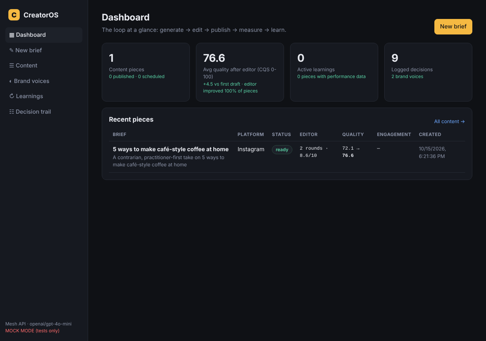
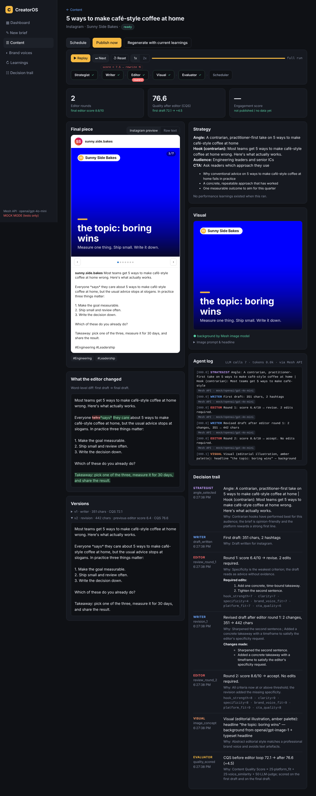
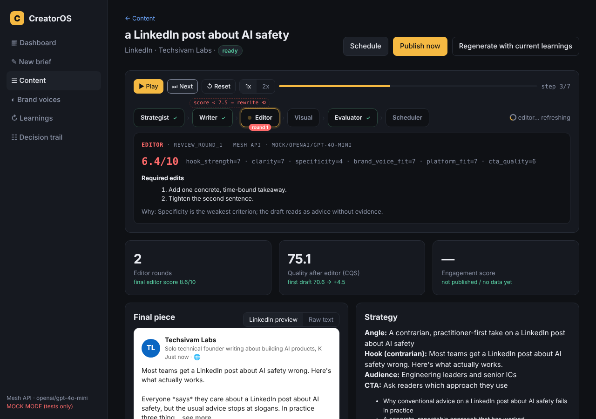

# CreatorOS — a self-improving, multi-agent content studio

Agent Arena 2026 · Track 03 · all LLM/AI calls go through **Mesh API** (`https://api.meshapi.ai/v1`).

A brief goes in ("a LinkedIn post about AI safety"). A **strategist** picks the angle, a **writer** drafts for
the platform in a **learned brand voice**, an **editor** critiques against six concrete criteria and the writer
revises until it passes, a **visual** agent generates a matching image, the piece is stored and **queued**,
published (simulated or real X API), **performance** is captured (real / user-entered / simulated), and a
**learner** distils it into rules that are injected into the next run. Every decision is logged with its
reason and linked to the piece. A quality score is computed before and after the editor loop and with and
without learnings — the numbers are in `eval/`.



## How the agents cooperate

```
                          ┌──────────── LangGraph StateGraph (app/graph/pipeline.py) ────────────┐
brief ──► strategist ──► writer ──► editor ──┬── accept ──► visual ──► finalize ──► stored piece
                            ▲                │
                            └── reviser ◄────┘ revise (score < 7.5 or over the platform limit)

stored piece ──► schedule (APScheduler) ──► publish ──► performance ──► learner ──► learnings
                                                                                        │
                                   injected into strategist / writer / editor prompts ◄─┘
```

| Agent | Job | Reads | Writes to the trail |
|---|---|---|---|
| Strategist | angle, hook, audience, key points, CTA, rejected alternatives | brief, brand voice, **learnings + engagement-by-feature table** | `angle_selected` + reasoning |
| Writer | platform-specific draft; later, revision with a change log | plan, brand voice, learnings, editor's required edits | `draft_written`, `revision_n` |
| Editor | 6-criteria score, verdict, numbered required edits (never rewrites) | draft + measured facts, plan, brand voice | `review_round_n` |
| Visual | background-only image prompt + headline/subline → Mesh image model → branded poster (Pillow typesets the text) | final text, angle, brand voice | `image_concept` (+ image-model status/error) |
| Learner | rules with confidence from engagement stats + best/worst texts | performance of published pieces | `learning_cycle` |
| Brand analyst | voice profile from ≥2 samples + measured style stats | samples | `voice_profile_learned` |

Each agent has its own prompt and output schema (`app/agents/`). The editor's verdict is derived in code from
its score and the platform's hard limit, so the loop is deterministic and auditable. The loop demonstrably
changes the text: the UI shows a word-level diff and both quality scores for every piece.





## Quick start

```bash
git clone <this repo> && cd creatorOS
cp .env.example .env          # set MESH_API_KEY=rsk_...
docker compose up --build -d  # app on http://localhost:8000, Postgres 16 inside
```

Open http://localhost:8000 → **Seed demo brands** (learns two deliberately different voices) → **New brief**.

Without Docker:

```bash
python -m venv .venv && . .venv/bin/activate      # Windows: .venv\Scripts\activate
pip install -r requirements.txt -r requirements-dev.txt
cp .env.example .env                               # MESH_API_KEY=rsk_...
uvicorn app.main:app --reload                      # SQLite in ./data by default
```

## The closed loop, step by step

1. **Brand voice** — *Brand voices → New brand*, paste ≥2 past posts. Profile + measured stats (emoji/post,
   chars/post, list usage…) are learned and injected into every prompt.
2. **Generate** — *New brief*, pick platforms (LinkedIn, X, Instagram, Blog). One piece per platform, each
   through the full pipeline with its own platform spec.
3. **Review** — the piece page shows the pipeline strip, a platform-native preview (LinkedIn card / X post /
   Instagram carousel / blog article), the editor diff, every version, the strategy, the poster, the agent log
   (Mesh model + tokens per call) and the decision trail; **Replay** steps through the run from the stored trail (angle → draft → critique with required edits → revision with change log → image
   concept → quality score).
4. **Schedule / publish** — queue for a time (APScheduler publishes when due) or publish now. Simulated
   publish synthesises engagement; set `X_*` keys for real posting to X with metrics read back.
5. **Feedback** — *Record performance* with real numbers, or let the simulator fill them in.
6. **Learn** — *Learnings → Run learning cycle*: engagement-per-feature statistics + an LLM distillation into
   rules with confidence and evidence. The next piece lists which learnings were applied; *Regenerate with
   current learnings* shows the difference on the same brief.

## Self-evaluation

Quality measure **CQS (0–100) = 25·platform_fit + 25·voice_similarity + 50·LLM-judge** —
`app/services/quality.py`. `scripts/evaluate.py` runs three experiments (editor loop before/after, learning
loop without/with, brand voice A vs B) and writes `eval/results.md` / `eval/results.json`.

```bash
python scripts/evaluate.py --briefs 4 --platforms linkedin,x
```

| Experiment | Metric | Result |
|---|---|---|
| A — editor loop | mean CQS first draft → after editor | _run the script with a real key and paste from `eval/results.md`_ |
| B — learning loop | mean CQS / engagement without → with learnings | _…_ |
| C — brand voice | each output closest to its own brand's samples | _…_ |

The committed `eval/results.md` currently holds a **mock-mode smoke run** (harness proof only, numbers not
meaningful); see `docs/07-self-evaluation.md` for the method and caveats.

## Tests

```bash
MESH_MOCK=1 pytest tests/unit tests/integration -q            # 38 tests, offline
playwright install chromium
MESH_MOCK=1 pytest tests/ui -q --browser chromium              # 9 Playwright browser tests
docker compose -f docker-compose.test.yml run --rm tests       # all of the above in a container
```

`MESH_MOCK=1` swaps the Mesh client for deterministic canned responses **for tests only** (the UI shows a
red "MOCK MODE" label); the product refuses to start without a Mesh key otherwise.

## Key design decisions (short)

- One gateway module for every AI call (`app/mesh/client.py`) — chat, images and embeddings all via Mesh.
- LangGraph graph with a real conditional loop (`editor → reviser → editor`), bounded by `EDITOR_MAX_ROUNDS`.
- Editor scores, code decides: verdict = score ≥ `EDITOR_PASS_SCORE` and within the platform's hard limit.
- Learning = reproducible statistics (stored) + LLM-distilled rules (with confidence) injected as prompt
  context; superseded rules are kept for audit.
- Engagement score weights comments ×4, shares ×5, saves ×3, clicks ×2, likes ×1, normalised by impressions.
- Transparent engagement simulator so the loop runs without credentials; real X metrics when configured.
- Decisions are written as they happen (live progress in the UI; partial trail survives failures).

Full list: `docs/06-design-decisions.md`.

## Repository layout

```
app/
  main.py            FastAPI app, static UI, scheduler lifecycle
  config.py          settings (env / .env)
  mesh/client.py     THE Mesh API gateway (chat / json / image / embeddings)
  agents/            strategist, writer, editor, visual, learner, brand, shared context
  graph/pipeline.py  LangGraph coordinator
  services/          studio (coordinator glue), brand, learning, publisher, scheduler, quality, features, demo
  api/routes.py      REST API
  models.py, db.py   SQLAlchemy models / sessions
  static/index.html  web UI
scripts/evaluate.py  self-evaluation · scripts/seed.py demo seed
tests/unit · tests/integration · tests/ui (Playwright)
docs/                requirements, system design, deployment design, tracking, test plan, decisions, evaluation, API
eval/                results of scripts/evaluate.py
Dockerfile · docker-compose.yml · docker-compose.test.yml · .github/workflows/
```

## Docs

- [Requirements](docs/01-requirements.md) · [System design](docs/02-system-design.md) ·
  [Deployment design](docs/03-deployment-design.md) · [Project tracking](docs/04-project-tracking.md) ·
  [Test plan](docs/05-test-plan.md) · [Design decisions](docs/06-design-decisions.md) ·
  [Self-evaluation](docs/07-self-evaluation.md) · [API reference](docs/08-api-reference.md)

## Submission checklist

- [x] Public repo with all code, `requirements.txt` (FastAPI + openai client), `.gitignore` with `.env`
- [x] `.github/workflows/agent-arena-2026-checks.yml` (add secrets `MESH_API_KEY`, `SUBMISSION_TOKEN`)
- [x] README: what, how agents cooperate, design decisions, self-evaluation
- [ ] Real-key run of `scripts/evaluate.py`, numbers pasted above
- [ ] Optional: demo video, deployed URL
